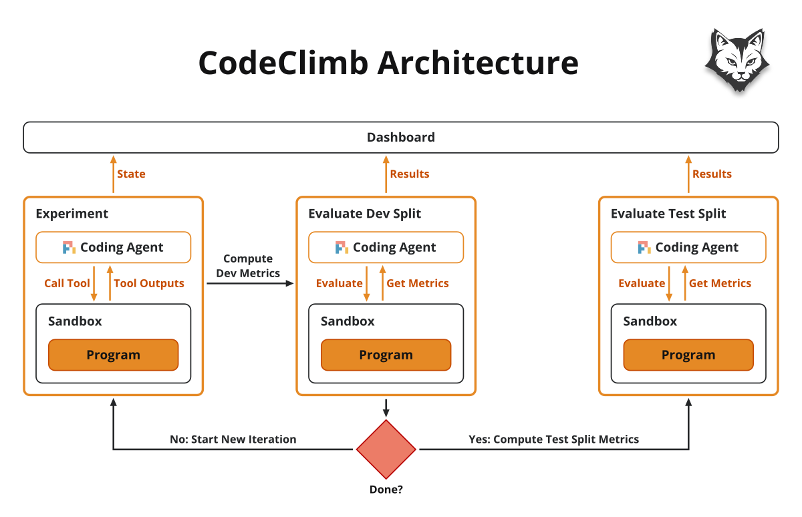
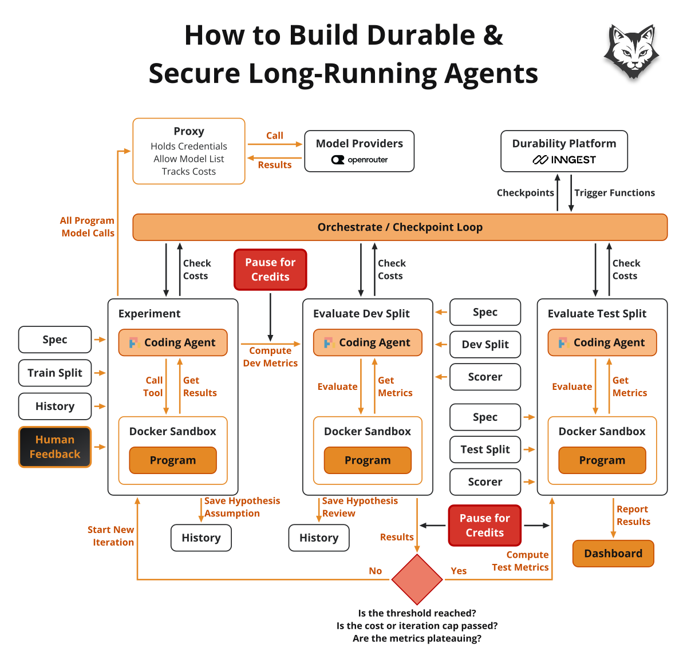
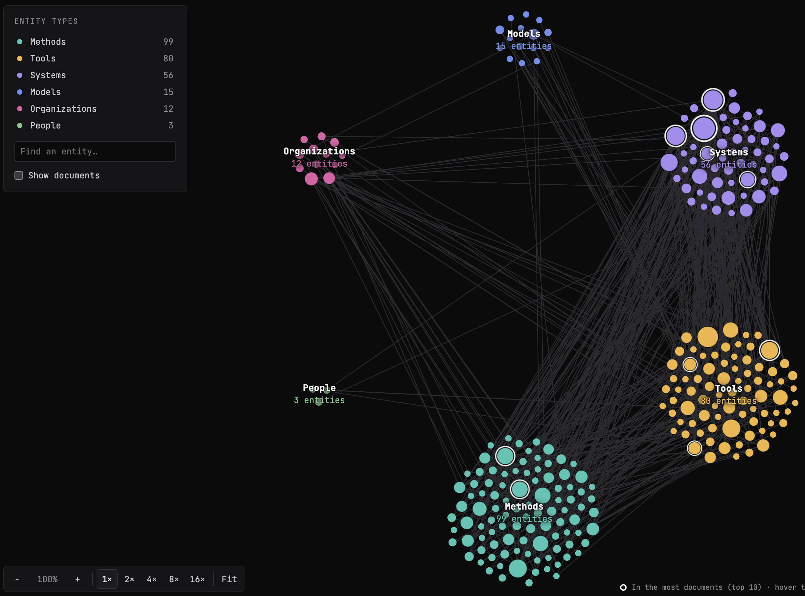
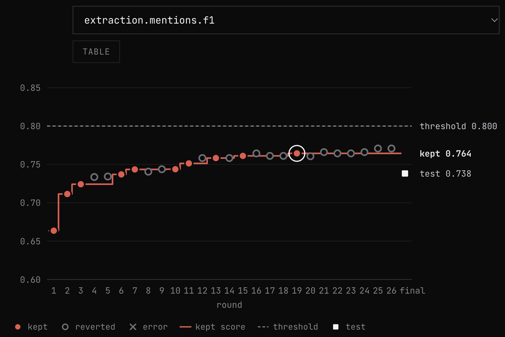
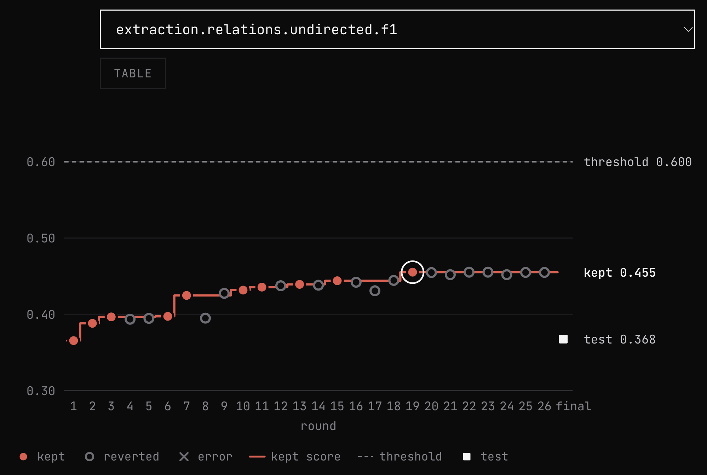
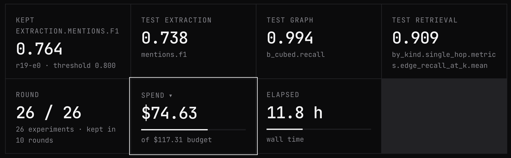
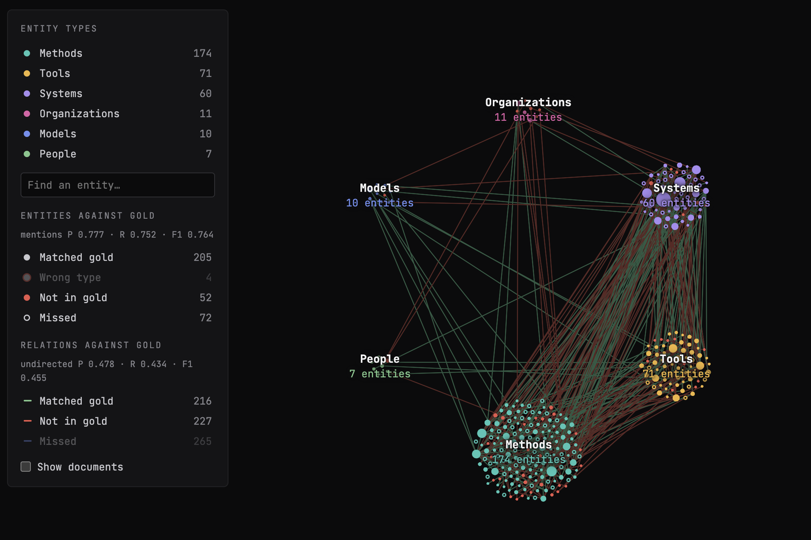
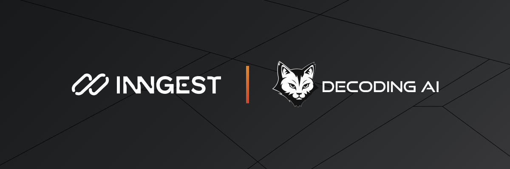

<div align="center">
  <h1>CodeClimb</h1>
  <h3>An overnight eval-driven code search: a coding agent climbs your metrics while you sleep</h3>
  <p><a href="#quickstart">Quickstart</a> · <a href="#guides">Guides</a> · <a href="#see-it-in-action">See it in action</a> · <a href="#learn-more">Learn more</a> · <a href="#questions-and-troubleshooting">Questions</a></p>
  <h3>Sponsored by&nbsp;
    <a href="https://inngest.link/dai-gh"><picture>
      <source media="(prefers-color-scheme: dark)" srcset="assets/sponsors/inngest-dark.svg">
      
    </picture></a>
  </h3>
</div>

<p align="center">
  <a href="LICENSE"></a>
  <a href="https://inngest.link/dai-gh"></a>
  =20">
</p>

You can't review a 23,546-line PR from a coding agent. And you can't leave one running overnight if it can burn your API credits, read your keys or lose hours of work in a 5 AM crash.

CodeClimb, inspired by Karpathy's autoresearch, makes your spec, dataset and metrics the signal. A Pi coding agent writes an experiment in a sandbox, a separate sandbox scores it on a dev split the coder never sees, and the loop keeps only what beats the best checkpoint.

Guardrails live in code, not in the prompt. A TypeScript orchestrator enforces the stop conditions and spend caps, a metering proxy holds the keys, and [Inngest](https://inngest.link/dai-gh) checkpoints every step, so a crash costs one round, never the night.

## How it works



- **Experiment** — a Pi coding agent in a Docker or [Inngest](https://inngest.link/dai-gh) sandbox; writes one commit per round from the spec, the train split and the decision history.
- **Evaluator** — a separate sandbox scores the commit on dev, and a reviewer agent writes the feedback for the next round; the coder never grades itself.
- **Guardrails** — a TypeScript orchestrator, not the agent, keeps a commit only when it beats the checkpoint by more than the measured noise, and ends the night on thresholds, rounds, deadline, budget or plateau.
- **Metering proxy** — holds the real credentials, allows only the config's models, and gives each session a one-off token with a dollar cap, revoked when the run ends.
- **Durability and a human in the loop** — [Inngest](https://inngest.link/dai-gh) saves every step, so a crashed night replays from the last one; an out-of-credits night pauses for free for up to 3 days until you resume it.

Layer by layer, the same loop becomes one you can leave unattended: the proxy, cost checks around every step, Inngest checkpoints, a credit pause that waits for a human, and a Next.js dashboard to watch, stop and resume nights.



## 📬 Learn to Build Long-Running Agents

> Join 45k+ engineers reading [the Decoding AI Magazine](https://www.decodingai.com/) and watching [the Decoding AI YouTube channel](https://www.youtube.com/@itsdecodingai) to learn to build durable, secure long-running agents.

<a href="https://www.decodingai.com/" target="_blank">
  
</a>

## Quickstart

**Needs:** Node.js 20+ · Docker running · no keys for the mock night · $0 ([cost by path](guides/01_setup.md#cost)) · no GPU

```bash
git clone https://github.com/decodingai-magazine/codeclimb.git && cd codeclimb
npm ci --ignore-scripts
npm run build:image                     # the codeclimb-python sandbox image
npm run dev:inngest                     # terminal 1: Inngest dev server, UI at http://localhost:8288
npm run worker                          # terminal 2: the connect() worker
npm run run-night -- --config configs/datenorm-smoke.yaml --mock   # terminal 3
```

In about 30 seconds the last command prints `done` and the night's `done.json` with `"stop_reason": "max_rounds"` and `"spend_usd": 0`: two rounds of sandboxes, commits, evaluations and reviews on scripted models. Results land in `runs-inngest/mock/datenorm-smoke/`.

**Set up with your coding agent:**

```txt
Clone https://github.com/decodingai-magazine/codeclimb, follow guides/ from 01_setup.md onward
(00_troubleshooting.md on any error), and set it up until npm test passes and
npm run run-night -- --config configs/datenorm-smoke.yaml --mock prints done.
Ask me for any API key it needs.
```

## Guides

| Guide | Read it when |
|---|---|
| [01_setup.md](guides/01_setup.md) | You install CodeClimb, add model credentials or [Inngest](https://inngest.link/dai-gh) Cloud keys, or want the cost of each run path |
| [02_running.md](guides/02_running.md) | You start, stop, resume, continue, seed or export a night, run graphrag, use [Inngest](https://inngest.link/dai-gh) Cloud or open the dashboard |
| [03_how_it_works.md](guides/03_how_it_works.md) | You need the loop's steps, the keep rule, the stops, the metering proxy, what stays off the sandbox, the files a night writes, the worker API or the code layout |
| [00_troubleshooting.md](guides/00_troubleshooting.md) | A command fails, a night pauses, or a score looks wrong |

## Who is this for

| Audience | What you get |
|---|---|
| AI engineers building measurable AI software (RAG, GraphRAG, extraction) | A loop that improves code against your dataset and metrics while you sleep, scored on dev every round and on test once, so you can spot overfitting |
| Engineers building or running long-running coding agents | Working patterns for spend caps the agent can't override, credentials it never reads, checkpoints and a credit pause with human resume |

## See it in action

**Build GraphRAG from a spec.** We gave CodeClimb a GraphRAG spec and 22 Decoding AI articles split 6 train / 8 dev / 8 test, with a gold knowledge graph extracted by Opus 5.5, Fable 5.1 and human review, then let it climb. The coder never sees dev or test: only the metrics and the reviewer's feedback reach it.

```bash
npm run run-night:cloud -- --config configs/graphrag.yaml
```

The knowledge graph it extracts on the test split:



Node extraction F1 climbed to 0.764 on dev (threshold 0.8) and scored 0.738 on test. Some reverted rounds score higher because the weighted score over all metrics is still lower:



Edge extraction, the harder problem, reached 0.455 on dev but only 0.368 on test, so relationships generalize worst:



Graph merge recall (0.994), retrieval recall (0.909) and MRR (0.922) all scored over 0.9 on test. The whole night: 26 rounds, 11.8 hours, $74.63, almost all of it the Opus 5.5 coder. With checkpoints, a crash costs at most one $2.87 round:



Then look at your data. Against gold, the dev graph has 72 missed entities and 52 extra ones, so the extractor loses more on recall than on precision, and some "extra" ones (such as "unified memory" as a system) are valid, so the gold needs another pass:



The screenshots are from a 26-round night with a larger budget; the shipped `graphrag.yaml` runs 24 rounds with a $60 cap, paid on an Anthropic key and OpenRouter. To check the loop for free first, run the [Quickstart](#quickstart) mock night.

## Learn more

| # | Article | Video |
|---|---|---|
| 1 | [How to Build a Durable and Secure Long-Running Agent](https://www.decodingai.com/p/build-durable-secure-long-running-agents) | — |

## Sponsors

<p align="center"><i>Thanks again to <a href="https://inngest.link/dai-gh"><b>Inngest</b></a> for sponsoring this project and keeping it free!</i></p>

<p align="center">
  <a href="https://inngest.link/dai-gh"></a>
</p>

<p align="center"><a href="https://inngest.link/dai-gh">Try Inngest for free here</a> (free plan with 50k executions/month, or self-host it, since it's open-source)</p>

<h3 align="center">Build AI agents and workflows that survive crashes, retries, and long waits:</h3>

<p align="center">
  <a href="https://inngest.link/dai-gh"></a>
</p>

## Questions and troubleshooting

Open a [GitHub issue](https://github.com/decodingai-magazine/codeclimb/issues) for questions and bugs. Known failures and their fixes are in [00_troubleshooting.md](guides/00_troubleshooting.md).

## 📬 Learn to Build Long-Running Agents

> Join 45k+ engineers reading [the Decoding AI Magazine](https://www.decodingai.com/) and watching [the Decoding AI YouTube channel](https://www.youtube.com/@itsdecodingai) to learn to build durable, secure long-running agents.

<a href="https://www.decodingai.com/" target="_blank">
  
</a>

## Star history

<a href="https://www.star-history.com/?type=date&repos=decodingai-magazine%2Fcodeclimb">
 <picture>
   <source media="(prefers-color-scheme: dark)" srcset="https://api.star-history.com/chart?repos=decodingai-magazine/codeclimb&type=date&theme=dark&legend=top-left" />
   <source media="(prefers-color-scheme: light)" srcset="https://api.star-history.com/chart?repos=decodingai-magazine/codeclimb&type=date&legend=top-left" />
   
 </picture>
</a>

## License

[Apache License 2.0](LICENSE)
