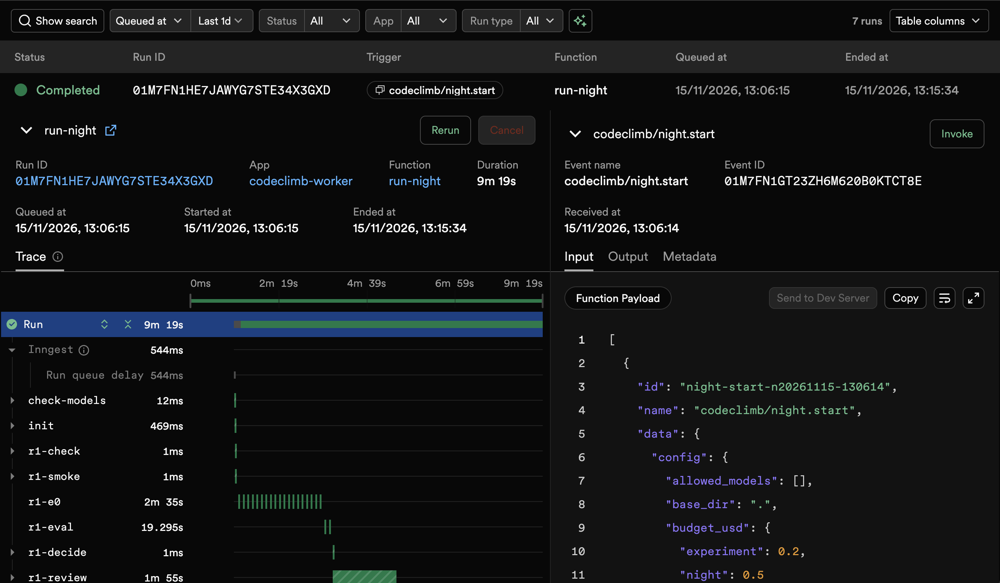

# Running CodeClimb

After this guide you can start, follow, stop, pause, resume, continue, seed and export a night, locally or on [Inngest](https://inngest.link/dai-gh) Cloud, and watch it in the dashboard. Every scenario needs [01_setup.md](01_setup.md) done first.

Scenarios follow the order a night runs in: services up, a night started, watched, ended, then reused.

## Dev server and worker

Needs: [01_setup.md](01_setup.md). Every local night needs both processes running, each in its own terminal.

Entry points: `scripts/worker.ts` (the `connect()` worker, app id `codeclimb-worker`), `inngest/codeclimb/functions.ts` (`run-night`, `run-experiment`, `run-evaluator`, the cleanup handlers and `distill-lessons`).

```bash
npm run dev:inngest
```

The dev server UI is at http://localhost:8288.

```bash
npm run worker
```

Prints:

```txt
[api] http://127.0.0.1:7421/api (metering proxy at /v1)
[worker] connected (<connection id>); functions: run-night, run-experiment, run-evaluator, night-stop-cleanup, run-cancelled-cleanup, distill-lessons
```

`npm run worker` sets `INNGEST_DEV=1`. Every script that loads `.env` through `codeclimb/env.ts` (`worker`, `run-night`, `lessons`, the smoke and sandbox scripts) defaults to `INNGEST_DEV=1` unless `CODECLIMB_ENV=cloud`, so the cloud keys in the shared `.env` never switch them to Inngest Cloud. The worker also serves the worker API and the metering proxy on `CODECLIMB_API_PORT` (default 7421). If another worker already holds that port (a Cloud worker, say), start this one with `CODECLIMB_API_PORT=7431`.

> [!WARNING]
> A worker restart onto new code cannot replay a night started by an older worker: let running nights finish, or stop them, first.

## Mock night

Needs: `## Dev server and worker`, and `codeclimb-python` built ([01_setup.md#sandbox-image](01_setup.md#sandbox-image)). Free: scripted models, no provider called, no credentials.

Entry points: `scripts/run-night.ts`; scripted models in `codeclimb/pi/mock.ts`.

```bash
npm run run-night -- --config configs/datenorm-smoke.yaml --mock
```

Prints `[run-night] mock: scripted models, metrics mean nothing`, `started night <id>`, one line per row, and, about 30 s later, `done` with the night's `done.json`: `"stop_reason": "max_rounds"`, `"rounds": 2`, `"spend_usd": 0` (measured on `0c395fd`):

```txt
  r1 experiment dev   r1-e0          accuracy=0.1250 keep   $0.0000 · mock change, no real work
  r2 noise      dev   r1-e0          accuracy=0.1250 keep   $0.0000 · the kept commit, scored again without replayed model calls: the evaluation's noise
  r2 experiment dev   r2-e0          accuracy=0.1250 revert $0.0000 · mock hypothesis
  r2 test       test  r1-e0          accuracy=0.1250 keep   $0.0000
```

- **Real:** Inngest, sandboxes, Pi sessions and their tools, commits, evals, the metering proxy, keep rules and reports.
- **Scripted:** the coder appends a line to `MOCK.md` with bash, the reviewer keeps nothing, and the program's model calls get a canned answer at no cost.
- **Results** land in `runs-inngest/mock/<results_path>`, away from real reports. Metrics mean nothing.

`--mock-offline N` makes the coder's model calls 2 to N+1 of the first experiment fail, as a lost connection. `capitals-smoke` with `--mock` exercises the metering proxy:

```bash
npm run run-night -- --config configs/capitals-smoke.yaml --mock
```

## Smoke night on real models

Needs: `## Dev server and worker`, Pi logged in to `github-copilot` ([01_setup.md#pi-model-providers](01_setup.md#pi-model-providers)). Spends up to $0.50 of Copilot subscription credit (an estimate).

Entry points: `scripts/run-night.ts`, `codeclimb/coder.ts`, `codeclimb/reviewer.ts`.

```bash
npm run run-night -- --config configs/datenorm-smoke.yaml
```

`run-night` checks every model first. If the worker's own `check-models` step then fails, `run-night` keeps following: read the error in the dev server UI and press Ctrl-C. Other flags: `--night-id ID` names the night, `--no-wait` starts it without following. Ctrl-C detaches; the night keeps running.

A smoke night in the dev server's **Runs** view (about 9 minutes on Copilot Haiku):



## Check results

Needs: a night that wrote `results.jsonl`. Entry points: `scripts/validate-results.ts`, `codeclimb/results.ts` (the schema).

```bash
npm run validate-results -- runs-inngest/mock/datenorm-smoke/results.jsonl
```

Prints `4 rows, 0 invalid` for the mock night above. Print the row schema:

```bash
npm run validate-results -- --schema
```

## Stop a night

Needs: a running night. Soft cancel: aborts Pi and destroys the night's sandboxes. Entry points: `scripts/run-night.ts`, `codeclimb/cleanup.ts`.

```bash
npm run run-night -- stop --night <night_id>
```

Prints `[run-night] sent codeclimb/night.stop for <night_id>`, then `stopped` and `stop.json` (or `done` if the night finished first). Stops, cancelled runs and the end of a night sweep every sandbox backend the worker reaches, so a stop never strands a billed sandbox.

## Pause and resume

Needs: a night paused out of credits. Entry points: `codeclimb/credits.ts`, `inngest/codeclimb/functions.ts`.

A night pauses instead of failing when a provider is out of credits; otherwise a program that gets a 402 on every call would score as a low F1, and the reviewer and keep rule would act on it.

- **What is detected.** A 402 or a key limit (403 `Key limit exceeded`) from OpenRouter on a program call, and a credit or quota error from Pi on a coder or reviewer turn. A rate limit is not a credit error: Pi retries it.
- **Where it stops.** The CLI prints `[run-night] paused, out of credits: <where>, <who> on <model>: <message>`; the night page and `nights/<id>/pause.json` say the same.
- **What is kept.** A coder commits its partial work and resumes the same Pi session. Finished evaluations stay; only the stopped ones rerun, and failed calls are not scored. Sandboxes are destroyed while paused, so nothing bills.
- **Limits.** A pause lasts 3 days, then the night stops. Stop works while paused. A child function never waits: it returns the stop to `run-night`, which waits on `codeclimb/night.resume`, because a waiting child would hit its `step.invoke` timeout.

Add credits, then:

```bash
npm run run-night -- resume --night <night_id>
```

Prints `[run-night] sent codeclimb/night.resume for <night_id>`. The night page's **Resume** button does the same. Paused time doesn't count against the deadline. Still out of credits? It pauses again at the same place.

## Dashboard

Needs: `## Dev server and worker`. Watches, stops and exports nights; it never starts them, never runs Pi or sandboxes.

Entry points: `app/` (pages), `app/api/worker/[...path]/route.ts` (proxy to the worker API, adds the token server side), `codeclimb/report/data.ts` (the report's data).

```bash
npm run dev
```

Serves http://127.0.0.1:3000 (loopback only, no login) and sets `INNGEST_DEV=1`. For a production build, which does not set it:

```bash
npm run build && npm run start
```

- **Nights** (`/`): every night on the worker's disk, with status, round, best score against the threshold, spend against the budget.
- **Live night** (`/nights/<id>`): status, spend and elapsed time against budget and deadline, **Stop**, the current experiment every 5 s (phase, elapsed, coder and dev spend, tokens), KPIs, the convergence chart and metric-family heatmap, each experiment's metrics, hypothesis and diff, and **Export** of kept commits as a `.tar.gz` git repo (files on `codeclimb/<exp_id>`, the kept lineage as history).

Type-check the app and the worker:

```bash
npm run typecheck
```

## Hello-world function

Needs: `npm run dev:inngest` and `npm run dev`. The original Inngest wiring check, separate from the loop. Entry points: `inngest/functions.ts` (triggered by `test/hello.world`), `app/api/hello/route.ts`, `app/api/inngest/route.ts`.

```bash
curl -X POST http://localhost:3000/api/hello -d '{"name": "codeclimb"}'
```

Then open **Runs** at http://localhost:8288. Or invoke `hello-world` from **Functions → Invoke** with `{ "data": { "name": "codeclimb" } }`. **Apps** should list `codeclimb` and **Functions** `hello-world`.

## datenorm-hard

Needs: `## Dev server and worker`. Entry point: `scenarios/datenorm-hard/` (it reuses the `datenorm` generators).

`datenorm` is fully specified, so one round solves it. `datenorm-hard` is built to need several:

- **Breadth.** 6 more families (`holiday`, `nth_weekday`, `yearless`, `multi_date`, `fuzzy`, `week_date`), about half the items.
- **Interference.** `invalid` gets traps aimed at loose fixes, such as `Augustine 23, 1990`, `part no. W37-5` and `Easter plans`.
- **A vague spec.** `SPEC.md` says which kinds of input appear, not the conventions behind the gold (which year `Nov 30` means, which of two dates counts). `METRICS.md` explains each family, so per-family accuracy tells the loop where to look. `HIDDEN_RULES.md` is the answer key and never reaches a sandbox.

```bash
npm run build:dataset:hard
```

No config ships for it: copy `configs/datenorm.yaml`, point `scenario:` at `scenarios/datenorm-hard`, then run `npm run run-night -- --config <your copy>`. Rebuild plain datenorm's gold with:

```bash
npm run build:dataset
```

## graphrag

Needs: `## Dev server and worker`, `codeclimb-graphrag` built ([01_setup.md#sandbox-image](01_setup.md#sandbox-image)), `uv` on the worker's PATH. Entry point: `scenarios/graphrag/scenario.yaml`. Gold and metrics: [scenarios/graphrag/README.md](../scenarios/graphrag/README.md); how it plugs in: [docs/scenario-contract.md](../docs/scenario-contract.md).

A GraphRAG system over 22 Decoding AI articles, scored in three stages, each on gold input: extraction (mention and relation F1), graph building (B-cubed precision and recall) and retrieval (per query kind).

- **Host side.** The evaluators run through `uv` with the scenario's `pyproject.toml`.
- **Train scorer.** The bundle's `scorer/` holds the official scorers with a train-only gold, so a coder can score its work on train.
- **Sandbox side.** The program is `python -m graphrag <stage> --root --inputs --out [--graph]` in the `codeclimb-graphrag` image.
- **Bundle.** The coder gets `spec/agent/`, the 6 train articles, train's gold graph, and train examples and inputs per stage. The export fails if any file names a dev or test document.
- **Metrics.** Flattened with the stage in front: `extraction.mentions.f1`, `graph.b_cubed.recall`, `retrieval.by_kind.single_hop.metrics.edge_recall_at_k.mean`.

```bash
npm run run-night -- --config configs/graphrag-smoke.yaml
```

The full night is `configs/graphrag.yaml` (24 rounds, $60 cap, Opus 5.5 coder and reviewer on `ANTHROPIC_API_KEY`, program models on `OPENROUTER_API_KEY`); run it on Cloud with `## Inngest Cloud` below.

## Overfit end-to-end scenario

Needs: `## Dev server and worker`. Entry point: `scenarios/datenorm/scripts/build_overfit.py`. `configs/e2e/overfit.yaml` runs on a generated scenario:

```bash
npm run build:scenario:overfit
```

Writes `generated/datenorm-overfit` (gitignored). `configs/e2e/budget.yaml` and `plateau.yaml` check the budget and plateau stops. All three are shared with the LangGraph stack.

## Inngest Cloud

Needs: `INNGEST_EVENT_KEY` and `INNGEST_SIGNING_KEY` in `.env` ([01_setup.md#inngest-cloud](01_setup.md#inngest-cloud)). Entry points: `codeclimb/env.ts` (mode checks), `scripts/worker.ts`.

The `:cloud` scripts set `CODECLIMB_ENV=cloud`, which requires both keys, refuses `INNGEST_DEV`, and pins the proxy port to 7422. Local nights always run on Docker; cloud nights use Docker on your machine or Inngest Sandboxes. Results land in the same `runs-inngest/` folders.

```bash
npm run worker:cloud
```

```bash
npm run run-night:cloud -- --config configs/datenorm-smoke.yaml
```

```bash
npm run run-night:cloud -- stop --night <night_id>
```

- Runs, traces and scores appear in the Inngest dashboard under the `codeclimb-worker` app.
- The local and cloud workers can run at the same time, since each only sees its own Inngest.
- The machine must stay on and online until the night ends: on macOS the worker holds `caffeinate -i` (closing the lid still sleeps it). If the worker drops off, Inngest Cloud keeps the run and retries the step on reconnect, and a coder resumes its Pi session; its sandbox keeps running meanwhile, which counts against its hour.

### Inngest Sandboxes

Needs: the cloud worker (the dev worker refuses it). Entry point: `codeclimb/sandbox/inngest.ts`.

Each coder and evaluator runs in a microVM with 2 vCPUs and 2 GB, on Inngest's base image (Python 3.14, git).

- **Setup.** Each coder sandbox gets `/spec` uploaded from the night's bundle and the git defaults the Docker image bakes in, so the scenario's `image` is ignored.
- **One hour per sandbox.** Inngest pauses a sandbox after one hour of active runtime. Coders get a new sandbox per experiment, and `timeouts.experiment_min` and `timeouts.eval_min` are at most 50. A round's evaluator is replaced before a candidate that might not finish in its hour, and latency is compared only between candidates on the same evaluator.
- **Network.** Egress is open, as on Docker. Gold and provider keys never enter a sandbox; with `allowed_models`, the coder prompt says to call models only through the endpoint.
- **Cleanup.** Inngest has no labels: a run's sandboxes are tracked in the worker's memory, and the night's prefix sweep covers a restarted worker.

```bash
npm run run-night:cloud -- --config configs/datenorm-smoke.yaml --sandbox inngest
```

**Metering tunnel.** Sandboxes can't reach `localhost`, so with `allowed_models` the proxy needs a public URL. Only `/v1` is published, and each call needs its evaluation's token, which carries a budget cap. Start a Cloudflare quick tunnel (free, no account) before the worker:

```bash
npm run tunnel:cloudflare
```

Or ngrok (needs an account; its plan caps bandwidth):

```bash
npm run tunnel
```

The worker finds either through its local API, Cloudflare first; `CODECLIMB_METER_URL` overrides both. It checks that the URL reaches the proxy before a coder or an evaluation starts and after each stage's run. Then:

```bash
npm run run-night:cloud -- --config configs/capitals-smoke.yaml --sandbox inngest
```

Check every backend method on one sandbox, and list the newest sandboxes:

```bash
CODECLIMB_ENV=cloud npx tsx scripts/smoke-inngest-sandbox.ts
```

```bash
CODECLIMB_ENV=cloud npx tsx scripts/sandboxes.ts
```

## Continue a night

Needs: an ended night. Entry point: `codeclimb/continuation.ts`. Runs more rounds under the same id.

```bash
npm run run-night:cloud -- continue --config configs/graphrag.yaml --direction "Work on multi-hop retrieval" --rounds 3
```

- `--night <id>` picks the night (default: the newest that ended under the config's `results_path`). `--rounds` adds to the rounds so far (default: the config's `max_rounds`); one run's budget is added to what the night spent. The night page has the same form.
- Rounds number on from the last one and start from the kept commit, with the last feedback and hypothesis, the round log and the rejected diffs. A direction goes to every new coder and reviewer and replaces the hypothesis. The bundle is rebuilt from the scenario as it stands.
- If `scenario.yaml`, the evaluators or the gold changed since the last run, one extra round scores the kept commit again first.
- Each run ends with its own test eval, so every continuation is another look at test: keep them few.

## Seed a new night

Needs: an ended night. Entry point: `scripts/run-night.ts`. A new night (own id, budget and trajectory) that starts from an earlier night's kept commit instead of the starter.

```bash
npm run run-night:cloud -- --config configs/graphrag.yaml --seed best
```

- `--seed` (or `seed:` in the config) takes a night id, `latest` (newest ended) or `best` (highest weighted dev score among nights scored by the current evaluators and gold; test never counts). Prints `[run-night] seed: <exp_id> (night <id>), <metric>=<score>`.
- Only the code and its dev scores carry over: the first round must beat them. What the earlier night learned arrives through the scenario's lessons, so a seed from a night that applies lessons waits until its distill has written them. If the evaluation changed since, one extra round scores the seed again first.
- Coders and reviewers read a `<start>` note naming the source night. `--direction TEXT` works here too.

## Lessons

Needs: an ended night on a scenario that declares `lessons` in `scenario.yaml`. Entry points: `scripts/lessons.ts`, `codeclimb/lessons.ts`; rules in [docs/scenario-contract.md](../docs/scenario-contract.md). Lessons are the only memory between nights; `distill-lessons` runs after each night, and this CLI does the same by hand.

```bash
npm run lessons -- distill --config configs/graphrag.yaml --night <night_id>
```

A paid model call. Prints `nothing new to distill from <night_id>` when there is nothing; `--apply` also writes the scenario's `lessons.md`.

```bash
npm run lessons -- apply --config configs/graphrag.yaml --night <night_id>
```

```bash
npm run lessons -- format --config configs/graphrag.yaml --check
```

Prints `<file> is in layout`, or exits 1 with `is out of layout`; drop `--check` to rewrite it.

## Export

Needs: a night with a kept commit. Entry points: `scripts/export.ts`, `codeclimb/export.ts`. The night page's **Export** panel downloads one as a git repo `.tar.gz`; from the terminal:

```bash
npm run export -- --config configs/datenorm.yaml --exp best --to-dir ../datenorm-solution
```

```bash
npm run export -- --config configs/datenorm.yaml --exp <exp_id> --to-dir ../datenorm-repo --with-history
```

```bash
npm run export -- --config configs/datenorm.yaml --exp best --to-remote git@github.com:you/repo.git --branch main
```

- `--exp best` is the kept commit of the most recently finished night; `--results <jsonl>` replaces `--config`.
- A folder export refuses a non-empty folder unless `--force`; `--with-history` needs an empty or new folder.
- A remote export pushes the lineage (starter → each kept parent → the experiment) to `codeclimb/<exp_id>` or `--branch`. It never force-pushes, so git rejects a push onto a diverged branch.
- Remotes are limited to `https`, `ssh`, `git` and local paths; option-like arguments and `ext::`/`fd::` transports are refused, and git never prompts for credentials.

## End-to-end checks

Needs: `## Dev server and worker`. Entry point: `.claude/skills/codeclimb-e2e/SKILL.md`. Run both mock nights from `## Mock night` (`capitals-smoke`, then `datenorm-smoke`), one after the other, and check the files the skill lists. Restart the worker after a code change.

Checks verified locally (dev server + Docker); across all of them `results.jsonl` validated and no `cc-*` container was left:

| Check | Config change | Result |
|---|---|---|
| Thresholds stop | `datenorm-smoke` with threshold 1.0 | Round 1 → test, `stop_reason: thresholds` |
| `max_rounds` + worker crash | `datenorm-smoke`, worker `kill -9` in round 2 | Pi sessions resumed on the same sandboxes; `stop_reason: max_rounds` |
| `$` cap | `budget_usd {experiment: 0.003, night: 0.02}` | Pi aborted per experiment; `stop_reason: budget` after round 1 |
| Deadline | `deadline: 30s`, threshold 1.01 | `stop_reason: deadline` after round 1 |
| Night stop | `run-night stop` mid round 1 | Parent and children `CANCELLED`, Pi aborted, sandboxes destroyed |

Next: [03_how_it_works.md](03_how_it_works.md)
