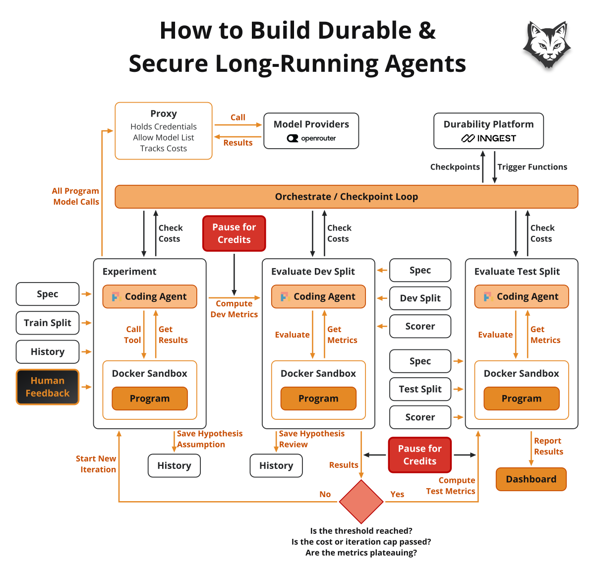

# How CodeClimb works

After this guide you know what each step of a night does, what stops it, what it writes to disk, the worker API the dashboard reads, and which file to open for each part.



## The night loop

A night is a linear loop: one experiment per round on `model`, each starting from the checkpoint (the last kept commit). Entry points: `inngest/codeclimb/functions.ts` (the [Inngest](https://inngest.link/dai-gh) functions), `codeclimb/orchestrator.ts` (the loop's logic).

0. **Smoke test.** Before any money goes into a round, the worker checks that every model answers its credentials and, for a metered program, that the proxy's public URL reaches the proxy. A failure is retried every 5 minutes, 6 times; then the night stops with `outage`.
1. **Experiment** (`run-experiment`, `codeclimb/coder.ts`). Pi gets a fresh sandbox with the scenario's image plus the checkpoint, the bundle (spec and train examples) at `/spec`, and the reviewer's feedback and hypothesis from the last round. It researches, plans tasks in `/tmp/tasks.json`, implements, and reviews its diff; the prompt asks for one task per threshold metric still short. A coder that stops too soon is sent back (at most eight times): a task neither done nor dropped, no train measurement in `/tmp/train-score.json`, or time and budget left before its reserve (the last 20% of either). It stops on done, timeout, the `$` cap, or the idle watchdog (10 minutes with no event, 25 with a tool running). The orchestrator commits `/repo` as one commit, `r<round>-e0`.
   - The coder's `/tmp/notes.md` plus the decision and the reviewer's verdict become `/spec/history/notes/<exp>.md`; later prompts hold the notes newest first, up to 12,000 characters.
   - A scenario's `check` (a host command) can block evaluation; its `scan` blocks a keep when the commit adds two or more held-out names.
2. **Evaluation on dev** (`run-evaluator`, `codeclimb/evaluate.ts`). The commit is cloned into its own sandbox. Per stage of `scenario.yaml`, the host writes the dev inputs (`inputs`), the sandbox runs the program (`run`), the host scores the outputs (`score`). The checkpoint is not rerun.
3. **Keep or revert** (`codeclimb/stats.ts`). Each metric in `thresholds` counts as `min(metric / threshold, 1)`; the weighted mean (`weights`, default 1) is the score. An experiment is kept when its score beats the checkpoint's by more than the noise margin and nothing blocks it (a failed gate, an empty stage output, held-out names in the diff). The starter scores 0.
4. **Review** (`codeclimb/reviewer.ts`). A reviewer model reads the spec, the scenario's `protocol`, the metrics and their change, per-item dev errors (cut to 70,000 characters per stage), the diff, the decision, and the coder's notes. It decides nothing: it writes feedback, one hypothesis per short metric (at most four), and a verdict. It never reads test data.
5. **After the decision.** A kept experiment becomes the checkpoint; a reverted one is dropped and the next round restarts from the same checkpoint. Every coder sees one line per earlier round and each rejected diff at `/spec/history/r<round>.diff` (40,000 characters). A commit that fails before scoring gets one repair per round if the budget allows. Within a night, repeated model calls replay their earlier answer for free, so unchanged code scores the same; an experiment identical to its parent is not evaluated (`unchanged`).
6. **Test.** After any stop, the final checkpoint is scored on test once, in its own evaluator.

### Noise margin

At the start of the first round whose checkpoint has scores, the checkpoint is evaluated once more with no replayed calls (an A/A run, a `noise` row). How far its threshold metrics moved, summed per weighted share, is the margin later experiments must beat, kept in `noise.json`. An experiment's margin is that move times the square root of its fresh-call share (`model_calls - model_calls_replayed` over `model_calls`): an A/A move of 0.022 with 9 of 83 calls fresh gives 0.0072. Two metrics that move apart add up instead of cancelling: one night's pair moved mention F1 +0.018 and relation F1 −0.008 for a raw score move of 0.00002. A failed A/A run is tried again the next round, and a capped one again on the next keep: at most two per night. The review sees both runs' scores. The margin is at least `min` (0.002), also before the A/A run or when it fails, and at most `max` (0.005): one pair is one sample, and a bad run in it (night n20261107-183056: an empty document, a move of 0.058) reverted a round that beat the checkpoint by 0.010 on both F1s. `noise_margin` in the config sets `min`, `max`, `fixed` and `scale_by_replay`.

### Stops

Checked between rounds; the reason lands in `done.json` as `stop_reason`.

| Stop | Config | When |
|---|---|---|
| `thresholds` | `thresholds` | The checkpoint's dev scores pass them |
| `outage` | | The round-start smoke test failed 7 times, 5 minutes apart |
| `max_rounds` | `max_rounds` | The last round finished |
| `deadline` | `deadline` | The deadline passed |
| `budget` | `budget_usd.night` | Spend plus the costliest round so far and the test eval would cross it |
| `tokens` | `max_tokens` (optional) | Coder and reviewer tokens plus the costliest round would cross it |
| `plateau` | `plateau_rounds` (default 3, `0` = off) | That many rounds in a row kept nothing |

## Standard metrics: latency and cost

Every scenario gets two metrics measured outside the coders' code (`codeclimb/standard-metrics.ts`):

- **Latency**: the hidden runner times each operation it sends the program and writes `timings.jsonl` (`{"op": "query", "id": "...", "ms": 12.3, "warmup": true}`; warm-ups count toward nothing). Gives `latency_<op>_p50_ms`, `_p95_ms`, `_total_s` and `latency_total_s`.
- **Cost**: the program's model calls only, metered by the proxy: `cost_usd`, `cost_per_item_usd`, `cost_<op>_usd`, `model_calls`. Coder and reviewer spend stays in `coder_usd` and `reviewer_usd`, the program's calls during coding in `dev_usd`; all count toward `budget_usd.night`.

The config chooses whether they are optimized:

```yaml
standard_metrics:
  latency: true                      # default true
  cost: true                         # default true
  latency_metric: latency_total_s    # default
  cost_metric: cost_per_item_usd     # default
  min_efficiency_gain: 0.10          # relative cut a change needs
```

An optimized metric is named to the coder and the reviewer; the reviewer decides whether a cut worth `min_efficiency_gain` is worth keeping.

## Metering proxy

A program may call models only when `allowed_models` lists some, and only through the proxy in the worker (`codeclimb/meter/`). Provider keys never enter a sandbox: each evaluation and each coder attempt gets a token for its own ledger, valid for `allowed_models` only, revoked when its run ends.

- **Program side.** The runner's environment has `OPENAI_BASE_URL` and `OPENAI_API_KEY` (also `CODECLIMB_LLM_BASE_URL` / `CODECLIMB_LLM_API_KEY`). The program calls `POST $OPENAI_BASE_URL/chat/completions` or `/embeddings`; the runner calls `POST $CODECLIMB_LLM_BASE_URL/_op` to attribute calls to an operation.
- **Coder side.** Pi's shell commands get the same variables, keyed to the experiment's ledger; that spend is `dev_usd`, logged to `nights/<id>/exps/<exp_id>/meter-dev.jsonl`.
- **Network.** Metered Docker sandboxes join `cc-meter`, with `cc-meter-relay` (a Python TCP relay on the scenario's image) forwarding to the proxy on the host. The worker leaves both in place between nights.
- **Limits.** `budget_usd.experiment` caps `coder_usd + dev_usd`; `budget_usd.night` caps the whole night. A cap is checked before each call. Errors: `401` bad or revoked token, `403` model not allowed, `402` budget spent, `400` unsupported request, `502` upstream failure.
- **OpenRouter.** `openrouter/<id>` models skip Pi: the proxy calls OpenRouter with `OPENROUTER_API_KEY`, forwards `response_format`, `seed`, `top_p`, `stop` and `reasoning`, and charges the reported `usage.cost`. Decisions models are served at `POST /v1/decisions`, rerank models at `POST /v1/rerank`.
- **Not supported yet.** Streaming, tools and non-text chat content; outside OpenRouter, embeddings only for `openai/text-embedding-3-small` and `-large` (priced in `codeclimb/meter/backends.ts`).

## Outputs on disk

A config's `results_path` is relative to `runs-inngest/` (gitignored); one that is absolute or leaves the folder is refused. The configs are shared unchanged with the LangGraph stack, which writes to `runs-langchain/`. Everything lands under `dirname(results_path)`:

| Path | Content |
|---|---|
| `results.jsonl` | One row per experiment and per extra eval. `reviewer_usd` repeats on every row of its round; `done.json` has the night's real spend |
| `experiments.git` | Bare repo, one commit per experiment, pinned by `refs/exp/<exp_id>` |
| `nights/<id>/night.json` | Resolved config, start time, deadline, metric-script hashes |
| `nights/<id>/done.json` | Stop reason, kept commit, test metrics |
| `nights/<id>/reviews/r<N>.json` | The reviewer's feedback and hypotheses for round N |
| `nights/<id>/pause.json`, `pauses.jsonl` | Where a paused night stopped (removed on resume), and every pause |
| `nights/<id>/exps/<exp_id>/session/*.jsonl` | Pi session transcripts, reopened to resume after a crash |
| `nights/<id>/evals/<eval_id>/` | Items with gold (host only), outputs, `timings.jsonl`, `meter.jsonl`, `metrics.json` |

## Worker API

The worker serves it on `CODECLIMB_API_HOST:CODECLIMB_API_PORT` (default `127.0.0.1:7421`), next to `connect()` and the proxy at `/v1` (`codeclimb/api.ts`):

| Endpoint | Purpose |
|---|---|
| `GET /api/nights`, `GET /api/nights/:id` | Night summaries from every `runs-inngest/**/nights/*` |
| `GET /api/nights/:id/live` | Summary plus the current experiment and the exportable experiments |
| `GET /api/nights/:id/report` | The night's report data (`ReportData`) the app renders |
| `POST /api/nights/:id/stop` | Send `codeclimb/night.stop` |
| `GET /api/nights/:id/export/:exp?format=repo\|source\|bundle` | Download an experiment |
| `POST /api/nights/:id/export/:exp` | `{kind: "dir", path}` or `{kind: "remote", url, branch?}` |

No token on loopback. Off loopback, set `CODECLIMB_API_HOST` and `CODECLIMB_WORKER_TOKEN` on the worker and `CODECLIMB_WORKER_URL` and `CODECLIMB_WORKER_TOKEN` on the app; every request but `/v1` then needs the bearer token.

```bash
curl -s http://127.0.0.1:7421/api/nights
```

Prints `{"nights":[{"id":"n…","scenario":"mock/datenorm-smoke","status":"finished","stop_reason":"max_rounds",…}]}` after the mock night.

## Project structure

| Path | Purpose |
|---|---|
| `inngest/codeclimb/functions.ts` | `run-night` (thin parent), `run-experiment` and `run-evaluator` (invoked children), cleanup handlers, `distill-lessons` |
| `inngest/client.ts`, `inngest/functions.ts` | The Next app's Inngest client (`id: "codeclimb"`) and the `hello-world` function |
| `scripts/worker.ts` | `connect()` worker, app id `codeclimb-worker`, which keeps Pi out of the Next bundle |
| `scripts/run-night.ts`, `scripts/export.ts`, `scripts/lessons.ts`, `scripts/validate-results.ts` | The CLIs |
| `scripts/smoke-*.ts`, `scripts/sandboxes.ts` | Pi and Inngest-sandbox smoke checks, sandbox listing |
| `codeclimb/` | Config, orchestrator, keep rule and statistics, git, eval, coder, reviewer, results schema, lessons, tracing; `*.test.ts` are the unit tests |
| `codeclimb/api.ts` | The worker API and `/v1` mount |
| `codeclimb/sandbox/` | `SandboxBackend` interface, Docker and Inngest backends, git-bundle transfer |
| `codeclimb/pi/` | Isolated Pi sessions, the sandboxed read/write/edit/bash tools, the mock models |
| `codeclimb/meter/` | The metering proxy and its provider backends |
| `codeclimb/report/` | The night page's data, read from disk, and the logo lockups |
| `app/` | Next.js app: Nights, the night page and its report (`app/nights/[id]/report/`), the `/api/worker` proxy, `/api/inngest`, `/api/hello` |
| `scenarios/<name>/` | One scenario ([contract](../docs/scenario-contract.md)): `scenario.yaml`, `starter/`, `spec/agent/`, `gold/`, `evaluators/`, `scripts/`. Shipped: `capitals`, `datenorm`, `datenorm-hard`, `graphrag` |
| `configs/` | `capitals-smoke`, `datenorm-smoke`, `graphrag-smoke` (short, Haiku via Copilot), `datenorm`, `graphrag`, and `e2e/` (budget, plateau, overfit) |
| `docker/` | `python.Dockerfile` (`codeclimb-python`), `graphrag.Dockerfile` (`codeclimb-graphrag`) |
| `inngest.json`, `.mcp.json` | Dev server config, the dev server's MCP endpoint |

## Deviations from the spec in this iteration

- **Models:** GitHub Copilot through Pi's `github-copilot` provider, not OpenCode Go. Coders are `claude-haiku-5.5`, the reviewer `claude-haiku-4.5`. `coder_usd` is Pi's list-price cost, not an actual charge on a subscription.
- **Local or Cloud:** the dev server or Inngest Cloud, a `connect()` worker on the laptop, Docker or Inngest sandboxes.
- **Network:** Docker and Inngest sandboxes have open egress, looser than the spec's allowlist. Gold and provider keys still never enter a sandbox.
- **Model calls by scenario:** `datenorm` and `datenorm-hard` are standard-library Python with no model calls, so their `allowed_models` is empty and `cost_usd` is 0; `capitals` and `graphrag` call models through the metering proxy.
- **Packages:** images ship uv. A coder adds packages with `uv add`; the evaluator rebuilds that environment from the commit's `uv.lock` before the first stage, outside any stage's clock.
- **Scenario directory:** a config names `scenario: scenarios/<name>`, whose `scenario.yaml` holds the image, the bundle command and the stage commands.
- **Fixed splits:** every scenario has fixed train/dev/test in `gold/splits.json`. Dev is scored every round, test once at the end; only train reaches a coder.
- **Extra row fields:** `kind` (experiment | test), `eval_id`, `night_id`; extra eval rows use `decision: keep` on success and `error` on failure.
- **Pi's base prompt** includes a `<docs>` block pointing at Pi's docs on the host. Nothing from AGENTS.md, skills, extensions or `~/.pi` is loaded.

Next: [../README.md#guides](../README.md#guides)
